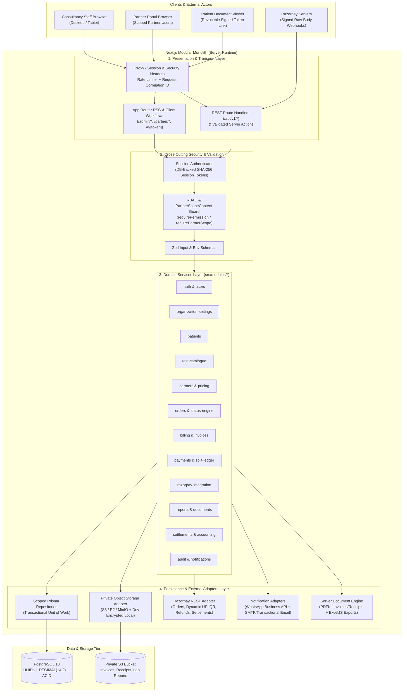
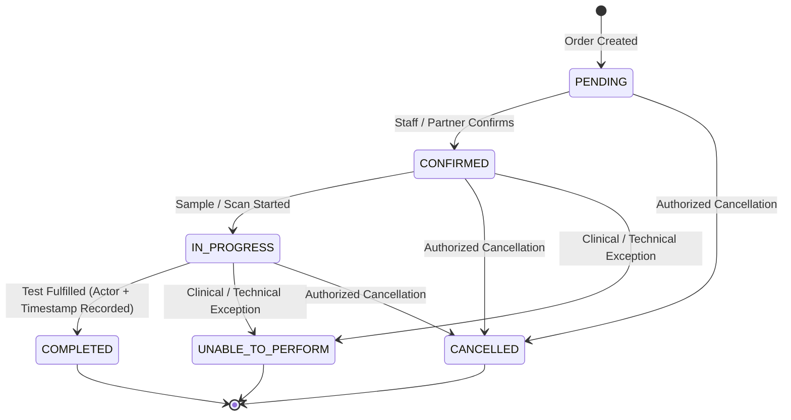
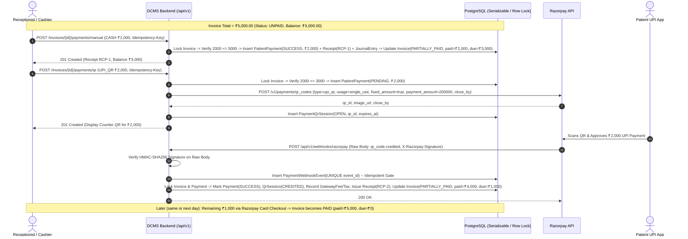

# System Architecture — Diagnostic Consultancy Management System (DCMS)

**Document Status:** Baseline Architecture v1.0  
**Source of Truth:** [Diagnostic_Consultancy_Management_System_PRD.md](./Diagnostic_Consultancy_Management_System_PRD.md) (v1.3)  
**Target Deployment:** India (`Asia/Kolkata` display timezone, `UTC` storage, `INR` `DECIMAL(14,2)` financial precision)

---

## 1. Architectural Vision & Context

DCMS is a commercial healthcare-operations and financial ERP built for an Indian diagnostic consultancy operating across **5–20 partner diagnostic centres** and **50–200 patients per month** initially, engineered to scale cleanly to thousands of monthly orders without premature distributed-systems overhead.

### 1.1 Core Domain Invariants
1. **Single-Partner Order Boundary:** Every `DiagnosticOrder` belongs to **one** `Patient` and **one** manually selected `Partner` diagnostic centre, containing one or more `OrderItem` rows. Multi-centre patient visits produce distinct orders per partner centre.
2. **Dual Commercial Models:**
   - **Model A (`CONSULTANCY_COLLECTS`):** Consultancy issues one immutable patient `Invoice` per order, collects payments (including mandatory multi-method **split payments** across one or more sessions), and owes negotiated partner purchase rates **only for `COMPLETED` test items** (`PAYABLE_TO_PARTNER`).
   - **Model B (`PATIENT_PAYS_PARTNER`):** Patient pays the partner centre directly. Consultancy **never** issues a patient diagnostic invoice; instead it records `PartnerInvoiceReference` / direct `CollectionRecord` metadata and earns a snapshotted percentage commission **only on `COMPLETED` test items** (`RECEIVABLE_FROM_PARTNER`). Direct partner collections never enter consultancy cash/bank totals.
3. **Historical Immutability:** Catalogue prices, negotiated partner purchase prices, discounts, tax rates, and commission rules are snapshotted onto `OrderItem` and `InvoiceItem` at transaction time. Issued invoices and posted settlements/journals are immutable; corrections occur exclusively via audited credit/debit notes, reversals, and adjustment entries.
4. **Strict Partner Data Isolation:** Partner portal users (`PARTNER_ADMIN`, `PARTNER_STAFF`, `PARTNER_REPORT_MANAGER`) are cryptographically and query-scoped to their assigned `partnerId`(s) in server-side repositories. They never receive consultancy selling prices, purchase margins, other partners' records, or the global patient registry.

---

## 2. Architectural Style: Layered Modular Monolith

DCMS uses a **strictly layered Modular Monolith** built on **Next.js (App Router, TypeScript strict mode)** and **PostgreSQL + Prisma ORM**.



### 2.1 Technology Decisions & Justifications

| Concern | Choice | Architectural Rationale |
|---|---|---|
| **Application Framework** | Next.js 16 (App Router) + React 19 + TypeScript 5 (`strict: true`, `noUncheckedIndexedAccess: true`) | Unified deployment unit for admin portal, partner portal, customer token viewer, and `/api/v1/*` JSON endpoints; zero CORS friction and end-to-end static type safety. |
| **Database & ORM** | PostgreSQL + Prisma ORM (`@prisma/client` v6 LTS) | First-class ACID interactive transactions (`prisma.$transaction`), `Decimal(14,2)` fixed-precision mapping, deterministic SQL migrations, and strict relational constraints (`ON DELETE RESTRICT`). |
| **Money & Rate Math** | `decimal.js` (wrapped in `src/lib/money`) | Eliminates IEEE-754 floating-point drift across split payments, pro-rata discounts, GST splits (`CGST`/`SGST`/`IGST`), and percentage commissions. Round-half-up (`ROUND_HALF_UP`) standardized to 2 decimal places (`paise` conversion exact integer `amount * 100`). |
| **Authentication & Sessions** | Custom Server-Side Database-Backed Session Engine (`src/lib/auth`) | `next-auth` v5 remains in beta (`5.0.0-beta.x`). For a healthcare financial system requiring **immediate session revocation** upon staff/partner deactivation, strict role/partner claims reloading per request, login rate-limiting, and audit logging, a dedicated server-side session engine (`crypto.scrypt` password hashing + 256-bit random token stored as SHA-256 hash in PostgreSQL `sessions` + `HttpOnly; SameSite=Lax; Secure` cookie) avoids beta auth magic and guarantees deterministic revocation. |
| **UI & Styling** | Tailwind CSS v4 + Accessible ERP Primitives (shadcn/ui architecture customized to `design.md` + native `<dialog>` / semantic HTML) | Enforces restrained healthcare ERP tokens (`2px–6px` radii, thin `1px` borders, `tabular-nums`, accessible contrast) without bloated runtime CSS-in-JS. |
| **PDF & Excel Generation** | `pdfkit` (server-side) + `exceljs` | Pure Node.js server-side binary generation without headless Chromium memory spikes on a compact Ubuntu VPS. Produces deterministic immutable PDF buffers hashed with SHA-256 before private storage upload. |
| **Private File Storage** | `StorageProvider` interface with `S3StorageAdapter` (`@aws-sdk/client-s3`) & `LocalPrivateStorageAdapter` (dev/test only) | Guarantees zero public bucket URLs. Every report, invoice PDF, and receipt PDF is stored under unguessable keys and served either via short-lived presigned URLs or permission-checked server streaming with `Content-Disposition` and `Cache-Control: private, no-store`. |
| **Testing Stack** | Vitest (unit, service, API, partner-isolation integration) + Playwright (E2E workflows) | Fast TDD feedback loop for financial invariants, webhook idempotency, and RBAC isolation, paired with browser-level verification of reception and partner portals. |

---

## 3. Domain Module Boundaries & Dependency Rules

All business logic resides in `src/modules/<domain>/`. React components (`src/app/`, `src/components/`) **never** import `prisma` or calculate taxes, balances, or commissions directly.

### 3.1 Layering Rules
1. **UI Components (`src/components/*`, `src/app/**/page.tsx`):** Render data props, manage local form UX state (`react-hook-form` + shared Zod schemas), and invoke Server Actions or `/api/v1/*` endpoints.
2. **Transport / Controllers (`src/app/api/v1/**/route.ts`, `src/modules/*/actions.ts`):** Authenticate request → construct `ActorContext` → verify RBAC permission & CSRF → parse input via Zod → call Domain Service → format standardized response / HTTP status code.
3. **Domain Services (`src/modules/*/service.ts`):** Enforce state transitions, commercial policies, open-decision configuration gates, idempotency checks, transactional boundaries (`db.$transaction`), audit emission, and ledger postings.
4. **Repositories (`src/modules/*/repository.ts`):** Encapsulate Prisma queries. Every partner-accessible repository method requires a mandatory `PartnerScope` parameter so unscoped queries cannot compile by accident.
5. **External Adapters (`src/lib/adapters/*`):** Isolate Razorpay, S3, WhatsApp Business API, and Email behind typed interfaces with structured timeouts, retries, and payload redaction.

### 3.2 Module Catalogue

| Module | Path | Core Responsibilities |
|---|---|---|
| `auth` | `src/modules/auth` | Sign-in, sign-out, password hashing (`scrypt`), password reset tokens, session lifecycle, rate-limit tracking. |
| `users` | `src/modules/users` | Consultancy & partner user CRUD, role assignment, activation/deactivation (with atomic session revocation), partner-user binding. |
| `organization` | `src/modules/organization` | Consultancy profile, GSTIN/tax codes, document numbering sequences, feature/policy flags for PRD Open Decisions. |
| `patients` | `src/modules/patients` | Patient registry, atomic `PAT-YYYY-NNNNN` code generation, search (`name`, `mobile`, `patientCode`), consent capture, patient clinical-order timeline. |
| `catalogue` | `src/modules/catalogue` | `TestCategory`, `Test`, `TestPackage`, `TestPackageItem`, active/inactive lifecycle without breaking historical orders. |
| `partners` | `src/modules/partners` | Partner diagnostic centres, `PartnerContract`, effective-dated `PartnerTestPrice`, `PartnerPackagePrice`, `PartnerCommissionRate` (with overlap prevention), capability mapping. |
| `orders` | `src/modules/orders` | Single-partner order creation, package-to-item expansion, commercial snapshot freezing, item & order state machine, audited amendments/cancellations. |
| `billing` | `src/modules/billing` | Model A `Invoice` issuance (`INV-...`), immutable tax & line snapshots, Model B `PartnerInvoiceReference` recording, Credit/Debit Note adjustments. |
| `payments` | `src/modules/payments` | Split-payment ledger (`PatientPayment`), manual cash/bank collection, overpayment block, balance derivation, `CollectionRecord` (Model B tracking). |
| `razorpay` | `src/modules/razorpay` | Server-side Razorpay Order creation, Checkout signature verification, single-use fixed-amount Dynamic UPI QR (`v1/payments/qr_codes`), Static QR unmatched reconciliation queue, raw-body webhook processor, gateway fee/tax & settlement batch reconciliation. |
| `receipts-refunds` | `src/modules/receipts` | Per-payment `PaymentReceipt` generation (`RCP-...`), partial/full `Refund` initiation & gateway sync, net-collected recalculation. |
| `documents` | `src/modules/documents` | PDF rendering (`Invoice`, `Receipt`, `Statement`, `Settlement`), S3 upload, revocable/expiring share tokens (`DocumentShareToken`), `InvoiceShareLog`. |
| `reports` | `src/modules/reports` | `ReportTracking` & versioned `ReportFile` uploads per `OrderItem`, magic-byte + MIME validation, SHA-256 checksums, authorized streaming download. |
| `settlements` | `src/modules/settlements` | Eligibility engine (strictly `COMPLETED` items + optional consultancy approval gate), `PAYABLE_TO_PARTNER` (Model A) & `RECEIVABLE_FROM_PARTNER` (Model B) statements, duplicate-settlement lock, `PartnerPayment` & `PaymentAllocation`, reversals/adjustments. |
| `accounting` | `src/modules/accounting` | Configurable `ChartOfAccounts`, `AccountingPeriod`, balanced immutable `JournalEntry` + `JournalEntryLine` postings, gateway-to-bank `ReconciliationRecord`. |
| `notifications` | `src/modules/notifications` | Approved WhatsApp Business template adapter & Email adapter, `NotificationTemplate`, `NotificationLog` with safe retry & zero medical leak in previews. |
| `audit` | `src/modules/audit` | Append-only `AuditLog` writer with automatic secret/PII redaction, correlation IDs, actor/IP/user-agent metadata, and before/after diffs. |
| `analytics` | `src/modules/analytics` | Executive & operational dashboard aggregations, all 13 PRD financial/operational registers, streaming ExcelJS exports. |

---

## 4. Directory Structure

```text
c:\Users\Admin\Desktop\DCMS\
├── Diagnostic_Consultancy_Management_System_PRD.md
├── architecture.md
├── design.md
├── database-design.md
├── api-specification.md
├── assumptions-and-open-decisions.md
├── security-and-privacy.md
├── implementation-plan.md
├── docs/
│   ├── deployment-and-operations.md
│   ├── backup-and-restore.md
│   ├── razorpay-sandbox-setup.md
│   └── whatsapp-email-setup.md
├── prisma/
│   ├── schema.prisma
│   ├── migrations/
│   └── seed.ts
├── scripts/
│   ├── backup-db.ps1
│   ├── backup-db.sh
│   └── restore-db.sh
├── src/
│   ├── app/
│   │   ├── (auth)/
│   │   │   ├── login/page.tsx
│   │   │   └── reset-password/page.tsx
│   │   ├── admin/
│   │   │   ├── layout.tsx
│   │   │   ├── dashboard/page.tsx
│   │   │   ├── patients/
│   │   │   ├── tests/
│   │   │   ├── packages/
│   │   │   ├── partners/
│   │   │   ├── orders/
│   │   │   ├── invoices/
│   │   │   ├── payments/
│   │   │   ├── refunds/
│   │   │   ├── reports/
│   │   │   ├── settlements/
│   │   │   ├── accounting/
│   │   │   ├── users/
│   │   │   ├── audit/
│   │   │   └── settings/
│   │   ├── partner/
│   │   │   ├── layout.tsx
│   │   │   ├── dashboard/page.tsx
│   │   │   ├── orders/
│   │   │   ├── reports/
│   │   │   ├── settlements/
│   │   │   ├── users/
│   │   │   └── profile/page.tsx
│   │   ├── d/
│   │   │   └── [token]/page.tsx          # Secure expiring customer document portal
│   │   └── api/
│   │       └── v1/                       # Versioned REST & Raw-Body Webhook Routes
│   ├── components/
│   │   ├── ui/                           # Restrained ERP Design System primitives
│   │   ├── layout/                       # AdminShell, PartnerShell, Topbar, SideNav
│   │   ├── forms/                        # Accessible RHF + Zod field wrappers
│   │   ├── tables/                       # Responsive sticky-header ERP DataTable
│   │   ├── billing/                      # Invoice summary, tax table, share drawer
│   │   ├── payments/                     # SplitPaymentComposer, DynamicQrModal
│   │   └── reports/                      # OrderItemReportUploader, RevisionHistory
│   ├── modules/                          # Domain logic (services, repositories, schemas)
│   │   ├── auth/
│   │   ├── users/
│   │   ├── organization/
│   │   ├── patients/
│   │   ├── catalogue/
│   │   ├── partners/
│   │   ├── orders/
│   │   ├── billing/
│   │   ├── payments/
│   │   ├── razorpay/
│   │   ├── receipts/
│   │   ├── documents/
│   │   ├── reports/
│   │   ├── settlements/
│   │   ├── accounting/
│   │   ├── notifications/
│   │   ├── audit/
│   │   └── analytics/
│   └── lib/
│       ├── env.ts                        # Fail-fast Zod environment validation
│       ├── db/                           # Prisma singleton & transaction helpers
│       ├── auth/                         # Session cookies, password crypto, CSRF
│       ├── permissions/                  # RBAC matrix, requirePermission, PartnerScope
│       ├── money/                        # Decimal.js fixed-precision arithmetic
│       ├── storage/                      # Private S3 + local dev storage adapters
│       ├── pdf/                          # Deterministic PDFKit templates
│       ├── excel/                        # ExcelJS workbook builders
│       ├── logger/                       # Structured PII-redacted logger
│       ├── rate-limit/                   # Sliding-window endpoint rate limiter
│       └── http/                         # Standardized API response & error envelopes
└── tests/
    ├── unit/                             # Money, split balance, commission, status machine, RBAC
    ├── integration/                      # Prisma transactions, webhook idempotency, partner isolation
    └── e2e/                              # Playwright reception & partner workflows
```

---

## 5. Critical Domain State Machines & Workflows

### 5.1 Order Item & Derived Order Status State Machine

Every `OrderItem` progresses independently; `DiagnosticOrder.status` is deterministically recomputed inside the same database transaction whenever any child `OrderItem` changes state.



**Derived Order Status Rules (`deriveOrderStatus(items)`):**
- All items `CANCELLED` → `CANCELLED`
- All active (non-cancelled / non-unable) items `COMPLETED` (and ≥1 `COMPLETED`) → `COMPLETED`
- ≥1 item `COMPLETED` and ≥1 item in (`PENDING`, `CONFIRMED`, `IN_PROGRESS`) → `PARTIALLY_COMPLETED`
- ≥1 item `IN_PROGRESS` (none `COMPLETED`) → `IN_PROGRESS`
- ≥1 item `CONFIRMED` (none `IN_PROGRESS`/`COMPLETED`) → `CONFIRMED`
- Otherwise → `PENDING`

**Financial Eligibility Rule:** Only `OrderItem` rows with `status = 'COMPLETED'` (and, when `OrganizationSettings.requireConsultancyApprovalForCompletion = true`, `completionApprovedAt IS NOT NULL`) can enter a Model A Payable or Model B Commission Receivable settlement.

### 5.2 Split Payment & Dynamic Razorpay UPI QR Sequence



### 5.3 Four-Stage Gateway Reconciliation Separation
DCMS strictly separates:
1. **Customer Payment Capture (`PatientPayment.status = SUCCESS`):** Updates patient invoice outstanding balance and issues customer receipt. Debit `Gateway Clearing Account`, Credit `Patient Accounts Receivable`.
2. **Gateway Fee & GST Recognition (`PaymentGatewayTransaction.gatewayFee`, `gatewayFeeTax`):** Recorded separately from invoice gross total so patient receipts show exact ₹ paid while consultancy accounting tracks gateway cost.
3. **Gateway Settlement Batch (`GatewaySettlement` + `GatewaySettlementAllocation`):** Tracks Razorpay `setl_xxxx` UTR batch grouping net payouts (`gross - fees - feeTax - refunds`).
4. **Actual Bank Credit Verification (`ReconciliationRecord`):** Accountant reconciles bank statement UTR credit against `GatewaySettlement`, moving funds from `Gateway Clearing Account` to `Operating Bank Account`.

---

## 6. Concurrency, Idempotency & Data Integrity

1. **Row-Level Locking on Financial Aggregates:** Every payment capture, refund initiation, credit-note application, and settlement generation acquires a pessimistic row lock (`SELECT ... FOR UPDATE` inside `prisma.$transaction`) on the parent `Invoice` or target `OrderItem` set so concurrent counter/webhook requests can never cause race-condition overpayments or double settlements.
2. **Dual Idempotency Keys:**
   - Client mutations (`POST /payments/*`, `POST /invoices/*/issue`, `POST /settlements`) accept an `Idempotency-Key` header persisted in `idempotency_records` (scoped to actor + route + payload SHA-256 hash) returning cached responses on network retries.
   - Razorpay webhooks enforce `UNIQUE (gateway, event_id)` on `payment_webhook_events` plus `UNIQUE (gateway, gateway_payment_id)` on `payment_gateway_transactions`.
3. **Sequential Document Numbering without Gaps on Rollback:** `invoice_sequences` (covering `PAT`, `ORD`, `INV`, `CN`, `DN`, `RCP`, `STL`, `JE`) increments atomically (`UPDATE invoice_sequences SET current_value = current_value + 1 ... RETURNING current_value`) inside the committing database transaction.

---

## 7. Observability, Operations & Deployment Architecture

- **Structured Redacted Logging:** JSON structured logs with `requestId`, `actorId`, `role`, `partnerScopeId`, `module`, `durationMs`, and automatic key-based + pattern-based redaction (`password`, `token`, `secret`, `authorization`, `x-razorpay-signature`, `aadhaar`, card PANs, webhook raw contact details).
- **Health & Operational Readiness:** `GET /api/v1/health` checks application liveness and PostgreSQL connectivity (`SELECT 1`), reporting degraded webhook backlog or storage connectivity to monitoring without leaking configuration secrets.
- **Target Production Topology (Ubuntu LTS VPS):**
  - **Nginx Reverse Proxy:** TLS 1.2/1.3 termination (Let's Encrypt), HTTP/2, request body size caps, upstream proxy buffering disabled only where streaming, raw-body pass-through for `/api/v1/webhooks/razorpay`.
  - **Application Process:** Docker Compose or `systemd`-managed Node.js 24 LTS process running `next start` behind loopback `127.0.0.1:3000`.
  - **Database:** Dedicated PostgreSQL 18 instance bound to private loopback/VPC interface, daily `pg_dump --format=custom` + WAL archiving encrypted via `age` / `gpg` to off-box S3 backup bucket, with scheduled monthly restore drills into a disposable verification database.

