# Database Design — Diagnostic Consultancy Management System (DCMS)

**Document Status:** Physical & Logical Schema Specification v1.0  
**Database Engine:** PostgreSQL 16+ (Verified on PostgreSQL 18) with Prisma ORM  
**Source of Truth:** [Diagnostic_Consultancy_Management_System_PRD.md](./Diagnostic_Consultancy_Management_System_PRD.md) (Section 9 & Appendix A)

---

## 1. Core Database Design Standards

1. **Primary Keys:** UUID (`@id @default(uuid()) @db.Uuid`) on all entity tables to prevent sequential ID enumeration (IDOR mitigation) and allow safe distributed/offline reference generation.
2. **Monetary & Percentage Precision:**
   - All currency amounts (`INR`): `DECIMAL(14, 2)` (`@db.Decimal(14, 2)`). Never `FLOAT`, `REAL`, or `DOUBLE PRECISION`.
   - All tax and commission percentages: `DECIMAL(7, 4)` (`@db.Decimal(7, 4)`), supporting rates such as `15.0000%` or `2.5000%` without rounding loss.
3. **Timestamps:** Stored in UTC (`TIMESTAMPTZ` / `@db.Timestamptz(3)`). Rendered in `Asia/Kolkata` (`IST`) at the presentation/PDF layer.
4. **Referential Integrity & Non-Destructive Deletes:**
   - All clinical, operational, financial, and audit foreign keys enforce `onDelete: Restrict`.
   - Soft deactivation (`isActive: Boolean`, `status` enums) is used for users, partners, tests, and packages so historical orders, invoices, and settlements never lose referential targets.
5. **Commercial Snapshots:** `order_items`, `invoices`, `invoice_items`, and `invoice_tax_snapshots` store frozen copies of names, codes, unit prices, discounts, tax rates, and commission formulas at transaction time.

---

## 2. Entity-Relationship Diagram (Core Domains)

```mermaid
erDiagram
    ORGANIZATION ||--|| ORGANIZATION_SETTINGS : configures
    ORGANIZATION ||--o{ INVOICE_SEQUENCE : numbers
    ORGANIZATION ||--o{ TAX_CODE : defines

    USER ||--o{ USER_ROLE : has
    ROLE ||--o{ USER_ROLE : assigned_to
    ROLE ||--o{ ROLE_PERMISSION : grants
    PERMISSION ||--o{ ROLE_PERMISSION : included_in
    USER ||--o{ PARTNER_USER : scoped_to
    PARTNER ||--o{ PARTNER_USER : employs

    PATIENT ||--o{ DIAGNOSTIC_ORDER : places
    PARTNER ||--o{ DIAGNOSTIC_ORDER : fulfils
    PARTNER ||--o{ PARTNER_CONTRACT : signs
    PARTNER ||--o{ PARTNER_TEST_PRICE : negotiates
    PARTNER ||--o{ PARTNER_COMMISSION_RATE : agrees

    TEST_CATEGORY ||--o{ TEST : groups
    TEST ||--o{ TEST_PACKAGE_ITEM : composes
    TEST_PACKAGE ||--o{ TEST_PACKAGE_ITEM : contains
    TEST ||--o{ ORDER_ITEM : snapshotted_on

    DIAGNOSTIC_ORDER ||--|{ ORDER_ITEM : contains
    DIAGNOSTIC_ORDER ||--o{ ORDER_STATUS_HISTORY : logs
    DIAGNOSTIC_ORDER ||--o| INVOICE : bills_model_a
    DIAGNOSTIC_ORDER ||--o| PARTNER_INVOICE_REFERENCE : records_model_b

    INVOICE ||--|{ INVOICE_ITEM : itemizes
    INVOICE ||--o{ INVOICE_TAX_SNAPSHOT : taxes
    INVOICE ||--o{ INVOICE_DOCUMENT : renders
    INVOICE ||--o{ INVOICE_ADJUSTMENT_NOTE : adjusts
    INVOICE ||--o{ PATIENT_PAYMENT : collects_split

    PATIENT_PAYMENT ||--o| PAYMENT_GATEWAY_TRANSACTION : processes_via
    PATIENT_PAYMENT ||--o{ PAYMENT_QR_SESSION : displays_qr
    PATIENT_PAYMENT ||--o| PAYMENT_RECEIPT : issues
    PATIENT_PAYMENT ||--o{ REFUND : refunds

    GATEWAY_SETTLEMENT ||--o{ GATEWAY_SETTLEMENT_ALLOCATION : allocates
    PAYMENT_GATEWAY_TRANSACTION ||--o{ GATEWAY_SETTLEMENT_ALLOCATION : settles

    ORDER_ITEM ||--o| REPORT_TRACKING : tracks
    ORDER_ITEM ||--o{ REPORT_FILE : attaches

    PARTNER ||--o{ SETTLEMENT : settles_with
    SETTLEMENT ||--|{ SETTLEMENT_ITEM : locks_completed
    ORDER_ITEM ||--o{ SETTLEMENT_ITEM : settled_in
    SETTLEMENT ||--o{ PAYMENT_ALLOCATION : paid_by
    PARTNER_PAYMENT ||--o{ PAYMENT_ALLOCATION : allocates
    SETTLEMENT ||--o{ PARTNER_ADJUSTMENT : adjusts

    JOURNAL_ENTRY ||--|{ JOURNAL_ENTRY_LINE : posts
    CHART_OF_ACCOUNT ||--o{ JOURNAL_ENTRY_LINE : classifies
```

---

## 3. Domain-by-Domain Table Specifications

### 3.1 Identity, Access Control & Audit (7 Tables)
1. **`users`**: `id (UUID PK)`, `email (UNIQUE, CITEXT/lowercased)`, `mobile (VARCHAR 20)`, `full_name`, `password_hash`, `portal_type (CONSULTANCY | PARTNER)`, `is_active`, `must_change_password`, `last_login_at`, `failed_login_count`, `locked_until`, `created_by_id`, `created_at`, `updated_at`.
2. **`sessions`**: `id (UUID PK)`, `session_token_hash (UNIQUE CHAR 64)`, `user_id (FK -> users)`, `ip_address`, `user_agent`, `expires_at`, `revoked_at`, `last_seen_at`, `created_at`. Index: `(user_id, revoked_at)`, `(expires_at)`.
3. **`password_reset_tokens`**: `id (UUID PK)`, `user_id (FK -> users)`, `token_hash (UNIQUE)`, `expires_at`, `used_at`, `created_at`.
4. **`roles`**: `id (UUID PK)`, `code (UNIQUE: SUPER_ADMIN, ADMIN, RECEPTIONIST, ACCOUNTANT, REPORT_MANAGER, VIEWER_AUDITOR, PARTNER_ADMIN, PARTNER_STAFF, PARTNER_REPORT_MANAGER)`, `name`, `scope (CONSULTANCY | PARTNER)`, `is_system`.
5. **`permissions`**: `id (UUID PK)`, `code (UNIQUE, e.g. patients:write, orders:create, invoices:issue, payments:collect, refunds:initiate, settlements:approve, reports:upload)`, `module`, `description`.
6. **`user_roles`** & **`role_permissions`**: Composite unique mappings `(user_id, role_id)` and `(role_id, permission_id)`.
7. **`partner_users`**: `id (UUID PK)`, `user_id (FK -> users)`, `partner_id (FK -> partners)`, `partner_role (PARTNER_ADMIN | PARTNER_STAFF | PARTNER_REPORT_MANAGER)`, `is_primary`, `is_active`. Unique: `(user_id, partner_id)`. Index: `(partner_id, is_active)`.
8. **`audit_logs`**: Append-only table. `id (UUID PK)`, `actor_user_id (FK nullable)`, `actor_role_snapshot`, `partner_scope_id (UUID nullable)`, `action (VARCHAR 100)`, `entity_type (VARCHAR 60)`, `entity_id (VARCHAR 64)`, `request_id`, `ip_address`, `user_agent`, `before_json (JSONB)`, `after_json (JSONB)`, `metadata_json (JSONB)`, `created_at`. Indexes: `(entity_type, entity_id, created_at DESC)`, `(actor_user_id, created_at DESC)`, `(partner_scope_id, created_at DESC)`, `(action, created_at DESC)`.

### 3.2 Organization, Numbering, Tax & Policy Settings (6 Tables)
9. **`organizations`**: `id (UUID PK)`, `legal_name`, `display_name`, `code (UNIQUE)`, `gstin (nullable)`, `pan (nullable)`, `cin (nullable)`, `registered_address`, `city`, `state_code (CHAR 2)`, `state_name`, `pincode`, `contact_email`, `contact_phone`, `website`, `logo_storage_key`, `signature_storage_key`, `created_at`, `updated_at`.
10. **`organization_settings`**: `id (UUID PK)`, `organization_id (UNIQUE FK)`, plus **explicit policy columns for PRD Open Decisions**:
    - `default_commission_basis (UNCONFIGURED | NET_AFTER_DISCOUNT_EXCL_TAX | GROSS_BEFORE_DISCOUNT_EXCL_TAX | NET_INCL_TAX)`
    - `require_consultancy_completion_approval (BOOLEAN DEFAULT false)`
    - `allow_invoice_overpayment (BOOLEAN DEFAULT false)`
    - `partner_patient_phone_visibility (MASKED | FULL DEFAULT 'MASKED')`
    - `require_settlement_approval (BOOLEAN DEFAULT true)`
    - `gst_enabled (BOOLEAN DEFAULT false)`
    - `static_qr_fallback_enabled (BOOLEAN DEFAULT false)`
    - `static_qr_vpa_label (VARCHAR nullable)`
    - `share_link_default_ttl_hours (INT DEFAULT 72)`
    - `invoice_terms_text (TEXT nullable)`
    - `invoice_footer_note (TEXT nullable)`
11. **`invoice_sequences`**: `id (UUID PK)`, `organization_id (FK)`, `doc_type (PATIENT | ORDER | INVOICE | CREDIT_NOTE | DEBIT_NOTE | RECEIPT | SETTLEMENT | JOURNAL)`, `financial_year (VARCHAR 9, e.g. 2026-27)`, `prefix (VARCHAR 20)`, `current_value (INT DEFAULT 0)`, `padding_length (INT DEFAULT 5)`. Unique: `(organization_id, doc_type, financial_year)`.
12. **`tax_codes`**: `id (UUID PK)`, `code (UNIQUE)`, `name`, `hsn_sac_code (VARCHAR 16)`, `supply_category (DIAGNOSTIC_SERVICE | CONSULTANCY_COMMISSION | OTHER_FEE)`, `cgst_rate DECIMAL(7,4)`, `sgst_rate DECIMAL(7,4)`, `igst_rate DECIMAL(7,4)`, `is_exempt BOOLEAN`, `effective_from DATE`, `effective_to DATE nullable`, `is_active BOOLEAN`.
13. **`payment_gateway_settings`**: `id (UUID PK)`, `provider (RAZORPAY)`, `environment (SANDBOX | PRODUCTION)`, `key_id_env_ref (VARCHAR)`, `webhook_enabled BOOLEAN`, `dynamic_qr_enabled BOOLEAN`, `supported_methods_json JSONB`, `updated_at`. *(Zero plaintext secrets stored in DB.)*
14. **`idempotency_records`**: `id (UUID PK)`, `key (VARCHAR 128)`, `actor_id (UUID)`, `route (VARCHAR 160)`, `request_hash (CHAR 64)`, `status_code INT`, `response_json JSONB`, `expires_at TIMESTAMPTZ`, `created_at`. Unique: `(actor_id, route, key)`.

### 3.3 Patients & Consents (3 Tables)
15. **`patients`**: `id (UUID PK)`, `patient_code (UNIQUE, e.g. PAT-2026-00001)`, `full_name`, `mobile (VARCHAR 20)`, `alternate_mobile (VARCHAR 20 nullable)`, `email (nullable)`, `date_of_birth (DATE nullable)`, `age_years_snapshot (SMALLINT nullable)`, `gender (MALE | FEMALE | OTHER | PREFER_NOT_TO_SAY)`, `address_line`, `city`, `state`, `pincode`, `is_active BOOLEAN`, `created_by_id (FK -> users)`, `updated_by_id (FK -> users nullable)`, `created_at`, `updated_at`. Indexes: `(mobile)`, `(full_name)`, `(created_at DESC)`.
16. **`patient_contacts`**: `id (UUID PK)`, `patient_id (FK -> patients)`, `contact_name`, `relationship`, `mobile`, `email`, `is_primary_guardian BOOLEAN`.
17. **`patient_consents`**: `id (UUID PK)`, `patient_id (FK -> patients)`, `consent_type (DATA_PROCESSING | WHATSAPP_COMMUNICATION | EMAIL_COMMUNICATION | PARTNER_SHARING)`, `granted BOOLEAN`, `captured_by_id (FK -> users)`, `captured_at TIMESTAMPTZ`, `revoked_at TIMESTAMPTZ nullable`, `notes`.

### 3.4 Test Catalogue & Packages (4 Tables)
18. **`test_categories`**: `id (UUID PK)`, `code (UNIQUE)`, `name`, `sort_order INT`, `is_active BOOLEAN`, `created_at`, `updated_at`.
19. **`tests`**: `id (UUID PK)`, `code (UNIQUE)`, `name`, `category_id (FK -> test_categories)`, `description`, `sample_type (nullable)`, `turnaround_hours INT nullable`, `default_selling_price DECIMAL(14,2)`, `tax_code_id (FK -> tax_codes nullable)`, `is_active BOOLEAN`, `created_at`, `updated_at`. Indexes: `(category_id, is_active)`, `(name)`.
20. **`test_packages`**: `id (UUID PK)`, `code (UNIQUE)`, `name`, `description`, `default_selling_price DECIMAL(14,2)`, `tax_code_id (FK -> tax_codes nullable)`, `is_active BOOLEAN`, `created_at`, `updated_at`.
21. **`test_package_items`**: `id (UUID PK)`, `package_id (FK -> test_packages)`, `test_id (FK -> tests)`, `quantity INT DEFAULT 1`, `allocation_weight DECIMAL(7,4) DEFAULT 1.0000` (used to deterministically allocate package selling price/discount down to individual `order_items` for item-level completion & settlement). Unique: `(package_id, test_id)`.

### 3.5 Partners, Contracts, Pricing & Commissions (6 Tables)
22. **`partners`**: `id (UUID PK)`, `partner_code (UNIQUE, e.g. PRT-001)`, `legal_name`, `display_name`, `contact_person`, `email`, `phone`, `address_line`, `city`, `state_code`, `state_name`, `pincode`, `gstin (nullable)`, `pan (nullable)`, `default_payment_model (MODEL_A_CONSULTANCY_COLLECTS | MODEL_B_PATIENT_PAYS_PARTNER)`, `payment_terms_days INT DEFAULT 15`, `bank_account_name`, `bank_account_number_masked`, `bank_ifsc`, `status (ACTIVE | INACTIVE | SUSPENDED)`, `notes`, `created_at`, `updated_at`.
23. **`partner_contracts`**: `id (UUID PK)`, `partner_id (FK -> partners)`, `contract_number (UNIQUE)`, `allowed_models (MODEL_A_ONLY | MODEL_B_ONLY | BOTH)`, `commission_basis (INHERIT_ORG | NET_AFTER_DISCOUNT_EXCL_TAX | GROSS_BEFORE_DISCOUNT_EXCL_TAX | NET_INCL_TAX)`, `settlement_cycle (WEEKLY | FORTNIGHTLY | MONTHLY | MANUAL)`, `effective_from DATE`, `effective_to DATE nullable`, `agreement_storage_key (nullable)`, `status (DRAFT | ACTIVE | EXPIRED | TERMINATED)`, `created_by_id`, `created_at`.
24. **`partner_test_prices`**: `id (UUID PK)`, `partner_id (FK -> partners)`, `test_id (FK -> tests)`, `agreed_purchase_price DECIMAL(14,2)`, `partner_mrp_reference DECIMAL(14,2) nullable`, `is_performed BOOLEAN DEFAULT true`, `effective_from DATE`, `effective_to DATE nullable`, `is_active BOOLEAN`, `created_by_id`, `created_at`. Indexes: `(partner_id, test_id, effective_from, effective_to)`. *(Service layer transactionally enforces non-overlapping active date windows per `(partner_id, test_id)`.)*
25. **`partner_package_prices`**: `id (UUID PK)`, `partner_id (FK -> partners)`, `package_id (FK -> test_packages)`, `agreed_purchase_price DECIMAL(14,2)`, `effective_from DATE`, `effective_to DATE nullable`, `is_active BOOLEAN`.
26. **`partner_commission_rates`**: `id (UUID PK)`, `partner_id (FK -> partners)`, `test_id (FK -> tests nullable; NULL = partner-wide default)`, `commission_percentage DECIMAL(7,4)`, `calculation_basis (NET_AFTER_DISCOUNT_EXCL_TAX | GROSS_BEFORE_DISCOUNT_EXCL_TAX | NET_INCL_TAX)`, `effective_from DATE`, `effective_to DATE nullable`, `is_active BOOLEAN`, `created_by_id`, `created_at`. Indexes: `(partner_id, test_id, effective_from)`.

### 3.6 Diagnostic Orders & Item Snapshots (3 Tables)
27. **`diagnostic_orders`**: `id (UUID PK)`, `order_number (UNIQUE, e.g. ORD-2026-00001)`, `patient_id (FK -> patients)`, `partner_id (FK -> partners)`, `contract_id (FK -> partner_contracts nullable)`, `payment_model (MODEL_A_CONSULTANCY_COLLECTS | MODEL_B_PATIENT_PAYS_PARTNER)`, `status (PENDING | CONFIRMED | IN_PROGRESS | PARTIALLY_COMPLETED | COMPLETED | CANCELLED)`, `referring_doctor (VARCHAR nullable)`, `clinical_notes (TEXT nullable)`, `internal_notes (TEXT nullable)`, `subtotal_selling DECIMAL(14,2)`, `discount_total DECIMAL(14,2)`, `tax_total DECIMAL(14,2)`, `net_selling_total DECIMAL(14,2)`, `partner_payable_estimate DECIMAL(14,2)`, `commission_estimate DECIMAL(14,2)`, `scheduled_at TIMESTAMPTZ nullable`, `cancelled_at TIMESTAMPTZ nullable`, `cancellation_reason TEXT nullable`, `created_by_id (FK -> users)`, `created_at`, `updated_at`. Indexes: `(patient_id, created_at DESC)`, `(partner_id, status, created_at DESC)`, `(status, created_at DESC)`.
28. **`order_items`**: `id (UUID PK)`, `order_id (FK -> diagnostic_orders)`, `test_id (FK -> tests)`, `source_package_id (FK -> test_packages nullable)`, `test_code_snapshot`, `test_name_snapshot`, `quantity INT DEFAULT 1`, `unit_selling_price_snapshot DECIMAL(14,2)`, `discount_amount_snapshot DECIMAL(14,2)`, `taxable_amount_snapshot DECIMAL(14,2)`, `tax_code_snapshot VARCHAR nullable`, `cgst_rate_snapshot DECIMAL(7,4)`, `sgst_rate_snapshot DECIMAL(7,4)`, `igst_rate_snapshot DECIMAL(7,4)`, `tax_amount_snapshot DECIMAL(14,2)`, `net_selling_amount_snapshot DECIMAL(14,2)`, `partner_unit_price_snapshot DECIMAL(14,2)`, `partner_net_payable_snapshot DECIMAL(14,2)`, `commission_percentage_snapshot DECIMAL(7,4) nullable`, `commission_basis_snapshot VARCHAR nullable`, `commission_amount_snapshot DECIMAL(14,2) nullable`, `status (PENDING | CONFIRMED | IN_PROGRESS | COMPLETED | CANCELLED | UNABLE_TO_PERFORM)`, `completed_at TIMESTAMPTZ nullable`, `completed_by_user_id (FK -> users nullable)`, `completion_approved_at TIMESTAMPTZ nullable`, `completion_approved_by_id (FK -> users nullable)`, `settlement_lock_status (UNSETTLED | IN_SETTLEMENT | SETTLED)`, `created_at`, `updated_at`. Indexes: `(order_id)`, `(status, settlement_lock_status)`.
29. **`order_status_history`**: `id (UUID PK)`, `order_id (FK -> diagnostic_orders)`, `order_item_id (FK -> order_items nullable)`, `previous_status VARCHAR`, `new_status VARCHAR`, `reason TEXT nullable`, `actor_user_id (FK -> users)`, `actor_portal (CONSULTANCY | PARTNER)`, `created_at`.

### 3.7 Invoices, Adjustments & Document Sharing (7 Tables)
30. **`invoices`**: *(Model A only; `UNIQUE (order_id)` for primary invoice)*. `id (UUID PK)`, `invoice_number (UNIQUE, e.g. INV-2026-00001)`, `order_id (UNIQUE FK -> diagnostic_orders)`, `patient_id (FK -> patients)`, `partner_id (FK -> partners)`, `status (DRAFT | UNPAID | PARTIALLY_PAID | PAID | PARTIALLY_REFUNDED | REFUNDED | VOID)`, `issue_date TIMESTAMPTZ`, `due_date TIMESTAMPTZ nullable`, `issuer_legal_name_snapshot`, `issuer_gstin_snapshot`, `issuer_address_snapshot`, `patient_name_snapshot`, `patient_code_snapshot`, `patient_mobile_snapshot`, `partner_name_snapshot`, `place_of_supply_state_code CHAR(2) nullable`, `subtotal_amount DECIMAL(14,2)`, `discount_amount DECIMAL(14,2)`, `taxable_amount DECIMAL(14,2)`, `cgst_amount DECIMAL(14,2)`, `sgst_amount DECIMAL(14,2)`, `igst_amount DECIMAL(14,2)`, `total_tax_amount DECIMAL(14,2)`, `grand_total DECIMAL(14,2)`, `credit_note_total DECIMAL(14,2) DEFAULT 0`, `debit_note_total DECIMAL(14,2) DEFAULT 0`, `effective_total DECIMAL(14,2)`, `amount_paid DECIMAL(14,2) DEFAULT 0`, `amount_refunded DECIMAL(14,2) DEFAULT 0`, `net_collected DECIMAL(14,2) DEFAULT 0`, `balance_due DECIMAL(14,2)`, `terms_snapshot TEXT nullable`, `issued_by_id (FK -> users)`, `voided_at TIMESTAMPTZ nullable`, `void_reason TEXT nullable`, `created_at`, `updated_at`. Indexes: `(patient_id, issue_date DESC)`, `(partner_id, status)`, `(status, issue_date DESC)`.
31. **`invoice_items`**: `id (UUID PK)`, `invoice_id (FK -> invoices)`, `order_item_id (FK -> order_items)`, `description_snapshot`, `test_code_snapshot`, `hsn_sac_snapshot`, `quantity INT`, `unit_price DECIMAL(14,2)`, `discount_amount DECIMAL(14,2)`, `taxable_amount DECIMAL(14,2)`, `cgst_rate DECIMAL(7,4)`, `cgst_amount DECIMAL(14,2)`, `sgst_rate DECIMAL(7,4)`, `sgst_amount DECIMAL(14,2)`, `igst_rate DECIMAL(7,4)`, `igst_amount DECIMAL(14,2)`, `line_total DECIMAL(14,2)`.
32. **`invoice_tax_snapshots`**: `id (UUID PK)`, `invoice_id (FK -> invoices)`, `tax_code_snapshot`, `hsn_sac_snapshot`, `taxable_value DECIMAL(14,2)`, `cgst_rate DECIMAL(7,4)`, `cgst_amount DECIMAL(14,2)`, `sgst_rate DECIMAL(7,4)`, `sgst_amount DECIMAL(14,2)`, `igst_rate DECIMAL(7,4)`, `igst_amount DECIMAL(14,2)`, `total_tax DECIMAL(14,2)`.
33. **`invoice_adjustment_notes`**: *(Immutable Credit/Debit Notes for issued invoice corrections)*. `id (UUID PK)`, `note_number (UNIQUE, CN-... / DN-...)`, `invoice_id (FK -> invoices)`, `note_type (CREDIT_NOTE | DEBIT_NOTE)`, `reason`, `taxable_delta DECIMAL(14,2)`, `tax_delta DECIMAL(14,2)`, `total_delta DECIMAL(14,2)`, `pdf_storage_key nullable`, `approved_by_id (FK -> users)`, `created_at`.
34. **`partner_invoice_references`**: *(Model B only — no consultancy patient invoice issued)*. `id (UUID PK)`, `order_id (UNIQUE FK -> diagnostic_orders)`, `partner_id (FK -> partners)`, `partner_invoice_number`, `partner_receipt_number nullable`, `invoice_date DATE`, `gross_amount DECIMAL(14,2)`, `discount_amount DECIMAL(14,2) DEFAULT 0`, `tax_amount DECIMAL(14,2) DEFAULT 0`, `net_amount_paid_by_patient DECIMAL(14,2)`, `payment_mode_reported VARCHAR nullable`, `document_storage_key VARCHAR nullable`, `recorded_by_id (FK -> users)`, `created_at`, `updated_at`.
35. **`invoice_documents`** & **`document_share_tokens`** & **`invoice_share_logs`**:
    - `invoice_documents`: `id`, `invoice_id (FK nullable)`, `receipt_id (FK nullable)`, `doc_kind (ISSUED_INVOICE_PDF | ACCOUNT_STATEMENT_PDF | RECEIPT_PDF | CREDIT_NOTE_PDF)`, `storage_key`, `sha256_checksum`, `file_size_bytes`, `generated_by_id`, `created_at`.
    - `document_share_tokens`: `id`, `token_hash (UNIQUE CHAR 64)`, `resource_type (INVOICE | RECEIPT | STATEMENT | REPORT)`, `resource_id UUID`, `expires_at`, `revoked_at nullable`, `max_views INT nullable`, `view_count INT DEFAULT 0`, `created_by_id`, `created_at`.
    - `invoice_share_logs`: `id`, `invoice_id nullable`, `receipt_id nullable`, `report_file_id nullable`, `channel (WHATSAPP | EMAIL | LINK_COPY | DOWNLOAD | PRINT)`, `destination_masked`, `share_token_id nullable`, `provider_message_id nullable`, `delivery_status (QUEUED | SENT | DELIVERED | FAILED | MANUAL)`, `error_message nullable`, `shared_by_id`, `created_at`.

### 3.8 Split Payments, Razorpay, QR, Receipts & Refunds (9 Tables)
36. **`patient_payments`**: `id (UUID PK)`, `invoice_id (FK -> invoices)`, `amount DECIMAL(14,2)`, `currency CHAR(3) DEFAULT 'INR'`, `payment_method (CASH | UPI_QR | UPI_ONLINE | CARD | NETBANKING | BANK_TRANSFER | WALLET | STATIC_QR_MANUAL | OTHER)`, `payment_status (PENDING | SUCCESS | FAILED | CANCELLED | EXPIRED | PARTIALLY_REFUNDED | REFUNDED)`, `payment_date TIMESTAMPTZ`, `collected_by_id (FK -> users nullable)`, `external_reference VARCHAR nullable`, `idempotency_key VARCHAR nullable`, `notes TEXT nullable`, `created_at`, `updated_at`. Indexes: `(invoice_id, payment_status)`, `(payment_date DESC, payment_method)`.
37. **`payment_gateway_transactions`**: `id (UUID PK)`, `payment_id (UNIQUE FK -> patient_payments)`, `gateway (RAZORPAY)`, `gateway_order_id VARCHAR nullable`, `gateway_payment_id VARCHAR nullable`, `gateway_qr_id VARCHAR nullable`, `gateway_signature_verified BOOLEAN DEFAULT false`, `gateway_method VARCHAR nullable`, `gateway_status VARCHAR`, `gross_amount DECIMAL(14,2)`, `gateway_fee DECIMAL(14,2) DEFAULT 0`, `gateway_fee_tax DECIMAL(14,2) DEFAULT 0`, `net_settlement_estimate DECIMAL(14,2) nullable`, `settlement_status (UNSETTLED | SETTLED_BY_GATEWAY | BANK_RECONCILED) DEFAULT 'UNSETTLED'`, `minimized_payload_json JSONB`, `verified_at TIMESTAMPTZ nullable`, `created_at`, `updated_at`. Unique: `(gateway, gateway_payment_id)` where `gateway_payment_id IS NOT NULL`.
38. **`payment_qr_sessions`**: `id (UUID PK)`, `payment_id (FK -> patient_payments)`, `invoice_id (FK -> invoices)`, `gateway_qr_id (UNIQUE VARCHAR)`, `qr_mode (DYNAMIC_SINGLE_USE | STATIC_FALLBACK)`, `amount DECIMAL(14,2)`, `qr_image_url TEXT nullable`, `qr_payload TEXT nullable`, `status (ACTIVE | CREDITED | EXPIRED | CLOSED | CANCELLED)`, `expires_at TIMESTAMPTZ`, `closed_at TIMESTAMPTZ nullable`, `created_by_id (FK -> users)`, `created_at`.
39. **`payment_webhook_events`**: `id (UUID PK)`, `gateway (RAZORPAY)`, `event_id VARCHAR`, `event_type VARCHAR`, `signature_verified BOOLEAN`, `processing_status (RECEIVED | PROCESSED | IGNORED_DUPLICATE | FAILED)`, `redacted_payload_json JSONB`, `error_message TEXT nullable`, `received_at TIMESTAMPTZ`, `processed_at TIMESTAMPTZ nullable`. Unique: `(gateway, event_id)`.
40. **`payment_receipts`**: `id (UUID PK)`, `receipt_number (UNIQUE, e.g. RCP-2026-00001)`, `payment_id (UNIQUE FK -> patient_payments)`, `invoice_id (FK -> invoices)`, `patient_id (FK -> patients)`, `amount DECIMAL(14,2)`, `payment_method_snapshot VARCHAR`, `invoice_balance_after DECIMAL(14,2)`, `pdf_storage_key VARCHAR nullable`, `issued_by_id (FK -> users nullable)`, `issued_at TIMESTAMPTZ`.
41. **`refunds`**: `id (UUID PK)`, `refund_number (UNIQUE)`, `payment_id (FK -> patient_payments)`, `invoice_id (FK -> invoices)`, `refund_method (GATEWAY_REVERSAL | CASH | BANK_TRANSFER)`, `gateway_refund_id (UNIQUE VARCHAR nullable)`, `amount DECIMAL(14,2)`, `reason TEXT`, `status (PENDING | PROCESSED | FAILED | CANCELLED)`, `requested_by_id (FK -> users)`, `approved_by_id (FK -> users nullable)`, `processed_at TIMESTAMPTZ nullable`, `created_at`.
42. **`gateway_settlements`** & **`gateway_settlement_allocations`**:
    - `gateway_settlements`: `id`, `gateway (RAZORPAY)`, `gateway_settlement_id (UNIQUE, setl_...)`, `utr_number VARCHAR nullable`, `gross_amount DECIMAL(14,2)`, `total_fee DECIMAL(14,2)`, `total_tax DECIMAL(14,2)`, `net_amount DECIMAL(14,2)`, `settled_at TIMESTAMPTZ`, `bank_reconciled_at TIMESTAMPTZ nullable`, `reconciled_by_id nullable`.
    - `gateway_settlement_allocations`: `id`, `gateway_settlement_id (FK)`, `gateway_transaction_id (FK)`, `allocated_gross DECIMAL(14,2)`, `allocated_fee DECIMAL(14,2)`, `allocated_tax DECIMAL(14,2)`, `allocated_net DECIMAL(14,2)`.
43. **`collection_records`**: *(Model B direct partner collection log & Static QR unmatched staging queue)*. `id`, `record_type (MODEL_B_PARTNER_DIRECT | STATIC_QR_UNMATCHED)`, `order_id (FK nullable)`, `partner_id (FK nullable)`, `matched_invoice_id (FK nullable)`, `matched_payment_id (FK nullable)`, `amount DECIMAL(14,2)`, `reference_number`, `collected_at TIMESTAMPTZ`, `reconciliation_status (UNRECONCILED | MATCHED | DISPUTED)`, `reconciled_by_id nullable`, `notes`.

### 3.9 Diagnostic Reports & File Access (3 Tables)
44. **`report_tracking`**: `id (UUID PK)`, `order_item_id (UNIQUE FK -> order_items)`, `status (AWAITING | PROCESSING | UPLOADED | REVIEWED | READY | DELIVERED)`, `expected_at TIMESTAMPTZ nullable`, `received_at TIMESTAMPTZ nullable`, `reviewed_by_id (FK -> users nullable)`, `delivered_at TIMESTAMPTZ nullable`, `updated_at`.
45. **`report_files`**: `id (UUID PK)`, `order_item_id (FK -> order_items)`, `version_number INT`, `original_filename VARCHAR(255)`, `mime_type VARCHAR(100)`, `file_size_bytes BIGINT`, `sha256_checksum CHAR(64)`, `storage_key (UNIQUE VARCHAR)`, `is_latest BOOLEAN DEFAULT true`, `uploaded_by_user_id (FK -> users)`, `uploaded_portal (CONSULTANCY | PARTNER)`, `superseded_at TIMESTAMPTZ nullable`, `notes TEXT nullable`, `created_at`. Index: `(order_item_id, is_latest)`.
46. **`document_access_logs`**: `id (UUID PK)`, `resource_type`, `resource_id UUID`, `actor_user_id nullable`, `share_token_id nullable`, `action (UPLOAD | DOWNLOAD | PREVIEW | REVOKE)`, `ip_address`, `user_agent`, `created_at`.

### 3.10 Partner Settlements & Double-Entry Accounting (8 Tables)
47. **`settlements`**: `id (UUID PK)`, `settlement_number (UNIQUE, STL-2026-00001)`, `partner_id (FK -> partners)`, `direction (PAYABLE_TO_PARTNER | RECEIVABLE_FROM_PARTNER)`, `commercial_model (MODEL_A_CONSULTANCY_COLLECTS | MODEL_B_PATIENT_PAYS_PARTNER)`, `period_start DATE`, `period_end DATE`, `status (DRAFT | PENDING_APPROVAL | APPROVED | PARTIALLY_SETTLED | SETTLED | CANCELLED | REVERSED)`, `gross_eligible_amount DECIMAL(14,2)`, `adjustments_amount DECIMAL(14,2) DEFAULT 0`, `tax_amount DECIMAL(14,2) DEFAULT 0`, `net_amount DECIMAL(14,2)`, `settled_amount DECIMAL(14,2) DEFAULT 0`, `balance_amount DECIMAL(14,2)`, `prepared_by_id (FK -> users)`, `approved_by_id (FK -> users nullable)`, `approved_at TIMESTAMPTZ nullable`, `reversed_by_settlement_id (UUID nullable)`, `notes TEXT nullable`, `created_at`, `updated_at`.
48. **`settlement_items`**: `id (UUID PK)`, `settlement_id (FK -> settlements)`, `order_item_id (FK -> order_items)`, `order_id (FK -> diagnostic_orders)`, `is_active_lock BOOLEAN DEFAULT true`, `test_name_snapshot`, `completed_at_snapshot TIMESTAMPTZ`, `base_amount DECIMAL(14,2)`, `commission_rate_snapshot DECIMAL(7,4) nullable`, `settlement_amount DECIMAL(14,2)`. **Duplicate-Settlement Prevention:** Partial unique index `CREATE UNIQUE INDEX settlement_items_active_order_item_Lock ON settlement_items (order_item_id) WHERE is_active_lock = true` (plus `order_items.settlement_lock_status` check inside serializable/row-locked transaction). Only when a settlement is formally `REVERSED` or `CANCELLED` is `is_active_lock` set to `false` with full audit history!
49. **`partner_payments`** & **`payment_allocations`** & **`partner_adjustments`**:
    - `partner_payments`: `id`, `partner_id (FK)`, `direction (OUTFLOW_TO_PARTNER | INFLOW_FROM_PARTNER)`, `amount DECIMAL(14,2)`, `unallocated_amount DECIMAL(14,2)`, `payment_method (NEFT | RTGS | IMPS | UPI | CHEQUE | CASH)`, `utr_or_reference`, `payment_date TIMESTAMPTZ`, `bank_account_id nullable`, `recorded_by_id`, `notes`, `created_at`.
    - `payment_allocations`: `id`, `settlement_id (FK -> settlements)`, `partner_payment_id (FK -> partner_payments)`, `allocated_amount DECIMAL(14,2)`, `allocated_by_id`, `created_at`.
    - `partner_adjustments`: `id`, `settlement_id (FK -> settlements)`, `partner_id (FK -> partners)`, `adjustment_type (CREDIT | DEBIT)`, `amount DECIMAL(14,2)`, `reason TEXT`, `approved_by_id`, `created_at`.
50. **`chart_of_accounts`**, **`accounting_periods`**, **`journal_entries`**, **`journal_entry_lines`**, **`bank_accounts`**, **`reconciliation_records`**, **`notification_templates`**, **`notification_logs`**:
    - `chart_of_accounts`: `code (UNIQUE: 1100 Cash on Hand, 1110 Operating Bank, 1120 Razorpay Clearing, 1200 Patient Receivables, 1210 Partner Commission Receivables, 2100 Partner Payables, 2200 Output CGST/SGST/IGST, 4100 Diagnostic Revenue Model A, 4200 Commission Revenue Model B, 5100 Partner Diagnostic Cost, 5200 Payment Gateway Fees)`, `name`, `account_type (ASSET | LIABILITY | EQUITY | REVENUE | EXPENSE)`, `is_system BOOLEAN`.
    - `journal_entries` & `journal_entry_lines`: Immutable posted entries (`entry_number`, `posting_date`, `reference_type`, `reference_id`, `reversal_of_entry_id nullable`), where `SUM(debit_amount) == SUM(credit_amount)` is asserted before commit.

---

## 4. Migration, Seeding & Backup Strategy

1. **Migrations:** Managed strictly through `prisma migrate dev` (development) and `prisma migrate deploy` (CI/production). Raw SQL post-migration step adds the PostgreSQL partial unique index on `settlement_items (order_item_id) WHERE is_active_lock = true` and `CHECK (amount > 0)` constraints on financial rows.
2. **Deterministic Synthetic Seed (`prisma/seed.ts`):** Populates roles, permissions, chart of accounts, organization profile (marked `[DEMO]`), sample test categories/tests/packages, 2 demo partner centres (one Model A, one Model B), demo staff & partner users, and clearly tagged synthetic patient records (`[DEMO] Aarav Kulkarni`, etc.) with zero real PII.
3. **Backup & Restore:** Automated daily `pg_dump -Fc` + SHA-256 manifest + `gpg`/`age` encryption, verified via `pg_restore` into an isolated verification database (`dcms_restore_check`) checking row counts and journal balance (`SUM(debit) - SUM(credit) = 0`).

